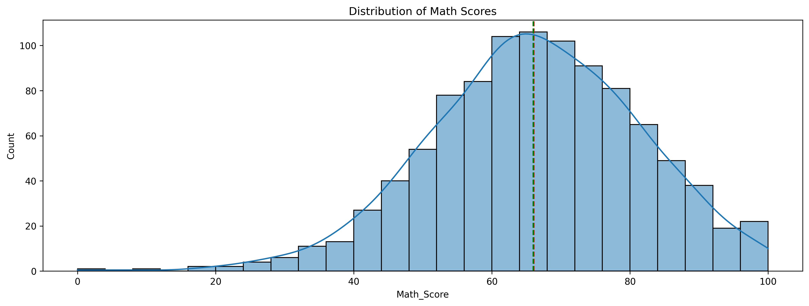
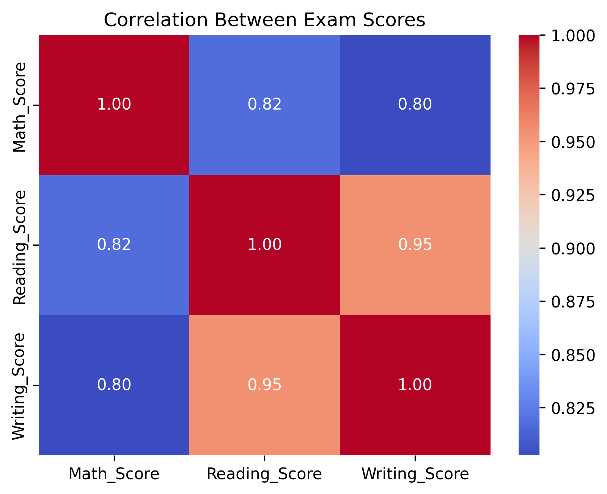
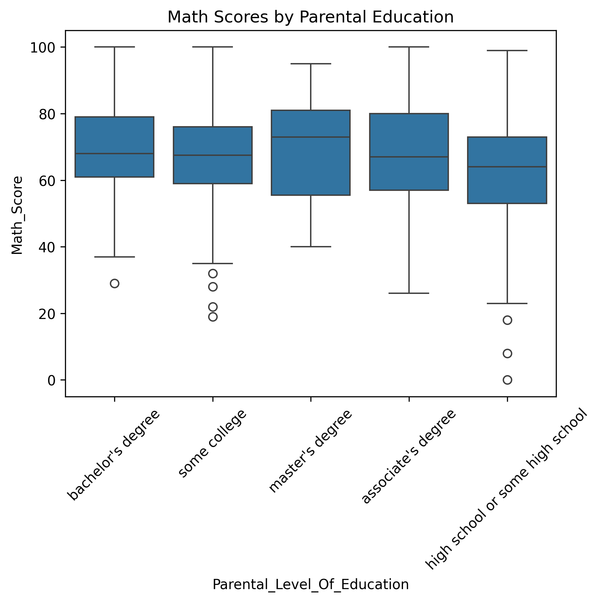

# Student Performance EDA

## 1. Project Overview

This project analyzes student exam performance using Python and data analysis tools. It explores student scores in Math, Reading, and Writing to understand the factors related to academic performance.

## 2. Business Problem and Objective

Schools need to understand student performance and identify factors related to exam results.

The main objective is to analyze student scores and provide useful information to help teachers and school administrators improve student support.

## 3. Dataset Summary

The dataset contains 1,000 student records and 8 original columns.

The dataset includes:
- Gender
- Race/Ethnicity
- Parental Level of Education
- Lunch
- Test Preparation Course
- Math Score
- Reading Score
- Writing Score

## 4. Methodology

The project followed these steps:

1. Data inspection and understanding.
2. Data cleaning and quality checks.
3. Data preparation and creation of new features.
4. Statistical analysis of Math Score.
5. Univariate analysis.
6. Multivariate analysis.
7. Conclusions and recommendations.

### Tools Used

- Python
- Pandas
- NumPy
- Matplotlib
- Seaborn
- SciPy
- Google Colab
- GitHub

## 5. Key Findings

### 5.1 Math Score Distribution

Math scores have an almost symmetric distribution with a small negative skew. However, the normality test showed that the scores are not normally distributed (p-value < 0.05).

### 5.2 Relationship Between Exam Scores

Reading and writing scores have a very strong positive relationship, with a correlation of 0.95. This means that students with higher reading scores usually have higher writing scores.

### 5.3 Test Preparation

Students who completed the test preparation course had higher average math scores than students who did not complete it. The statistical test showed a significant difference between the two groups.

## 6. Recommendations

- Provide test preparation courses for students.
- Give extra support to students with low scores.
- Encourage reading activities to support writing skills.
- Provide equal learning opportunities for all students.
- Monitor student performance to identify students who need help.

## 7. Limitations

- The dataset contains only 1,000 students.
- Some important factors, such as study time and attendance, are not included.
- The analysis shows relationships but does not prove cause and effect.
- The results may not represent all schools and students.

## 8. Next Steps

- Collect data from more students and schools.
- Study additional factors related to student performance.
- Compare results across different schools.
- Develop better student support programs.

## 9. Technical Notebook

The complete analysis and Python code are available in the notebook:

[Student Performance EDA Notebook](Student_Performance_EDA.ipynb)

---

**Project:** Student Performance Exploratory Data Analysis (EDA)
